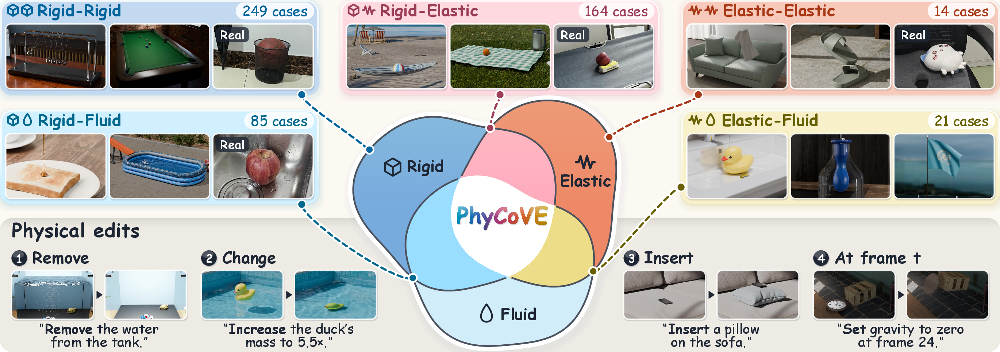
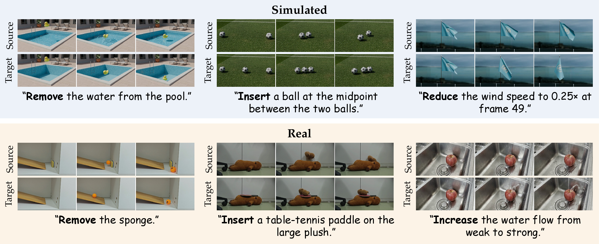
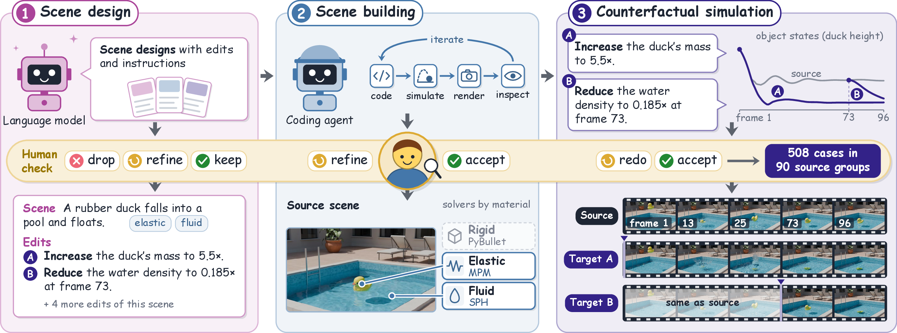
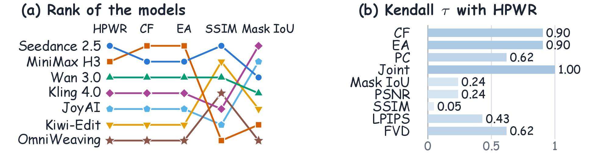
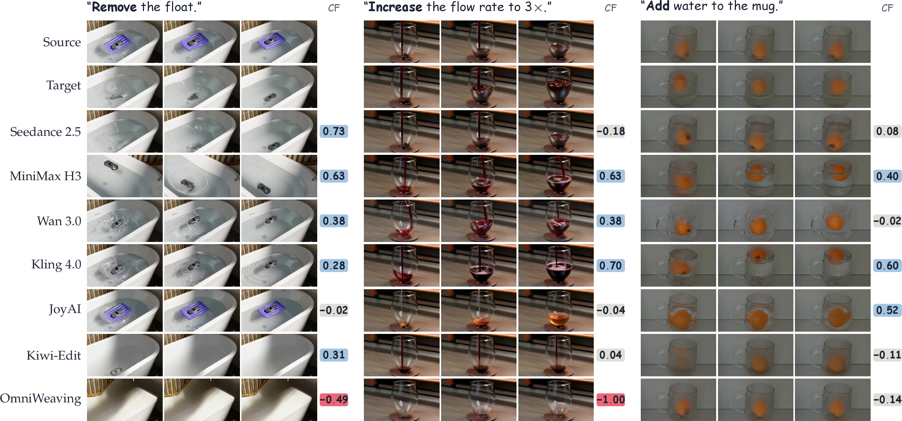

<h1 align="center">
  PhyCoVE: Benchmarking Physical Counterfactual<br>
  Video Editing across Diverse Material Dynamics
</h1>

<p align="center">
  <a href="mailto:chyue25@m.fudan.edu.cn" title="Email Conghan Yue">Conghan Yue</a><sup>*</sup>, Yuanjie Chen<sup>*</sup>, Yunyan Xiao, Zeyu Peng, Xingsong Ye, Ya Gao,<br>
  Yanglin Huang, WeiYao Zhang, Yue Han, Zhineng Chen<sup>&dagger;</sup>, Yu-Gang Jiang<sup>&dagger;</sup><br>
  Institute of Trustworthy Embodied AI, Fudan University<br>
  <sup>*</sup> Equal contribution &nbsp;&middot;&nbsp; <sup>&dagger;</sup> Corresponding authors
</p>

<p align="center">
  <picture></picture>
</p>

<p align="center">
  <a href="https://arxiv.org/pdf/2611.29184"></a>
  <a href="https://arxiv.org/abs/2611.29184"></a>
  <a href="https://phycove.github.io/"></a>
  <a href="https://huggingface.co/datasets/ccmoony/PhyCoVE"></a>
</p>

<p align="center">
  
</p>
<p align="center">
  <em><strong>Figure 1: Overview of PhyCoVE.</strong> Five material-interaction patterns across rigid, elastic, and fluid dynamics, covering object removal, physical quantity changes, object insertion, and later-frame interventions.</em>
</p>

---

## Overview

**PhyCoVE** benchmarks **physical counterfactual video editing (PCVE)**: given a source video and a language-specified physical edit at a target execution frame, a model must preserve the source history before that frame and generate the counterfactual evolution that follows.

- **533 editing cases across 110 source groups** (90 simulated scenes / 508 cases + 20 real-recorded scenes / 25 cases; 643 unique videos).
- **Unified video format**: `1280 × 720`, H.264, `24 fps`, `96 frames` (4 s), with vague and quantitative instructions in both English and Chinese.
- **Three edit axes**: **Remove** (178 cases), **Change** a physical quantity or initial state (334 cases), and **Insert** (21 cases), including **63 later-frame edits** ($t > 1$).
- **Counterfactual target videos & 3D states**: every case pairs a source video with its counterfactual target video; simulated scenes also export per-frame 3D object states.

<p align="center">
  
</p>
<p align="center">
  <em><strong>Figure 2: Representative cases from PhyCoVE.</strong> Each case pairs a source video and a physical edit at its execution frame with a counterfactual target video across simulated and real-recorded scenes.</em>
</p>

### Comparison with Related Benchmarks

<table>
  <thead>
    <tr>
      <th rowspan="2" align="left">Benchmark</th>
      <th rowspan="2" align="center">Task</th>
      <th colspan="2" align="center">Reference</th>
      <th colspan="3" align="center">Dynamics</th>
      <th rowspan="2" align="center">Real</th>
    </tr>
    <tr>
      <th align="center">Target</th>
      <th align="center">States</th>
      <th align="center">R</th>
      <th align="center">E</th>
      <th align="center">F</th>
    </tr>
  </thead>
  <tbody>
    <tr><td>NRVBench</td><td align="center">Edit</td><td align="center">✗</td><td align="center">✗</td><td align="center">✗</td><td align="center">✓</td><td align="center">✓</td><td align="center">✓</td></tr>
    <tr><td>VOID</td><td align="center">Edit</td><td align="center">✓<sup>†</sup></td><td align="center">✗</td><td align="center">✓</td><td align="center">✓</td><td align="center">✗</td><td align="center">✓</td></tr>
    <tr><td>PCVE-RigidBench</td><td align="center">Edit</td><td align="center">✓</td><td align="center">✓</td><td align="center">✓</td><td align="center">✗</td><td align="center">✗</td><td align="center">✗</td></tr>
    <tr><td>VideoPhy</td><td align="center">Gen.</td><td align="center">✗</td><td align="center">✗</td><td align="center">✓</td><td align="center">✓</td><td align="center">✓</td><td align="center">✗</td></tr>
    <tr><td>Physics-IQ</td><td align="center">Gen.</td><td align="center">✗</td><td align="center">✗</td><td align="center">✓</td><td align="center">✓</td><td align="center">✓</td><td align="center">✓</td></tr>
    <tr><td>CRONOS</td><td align="center">Gen.</td><td align="center">✗</td><td align="center">✗</td><td align="center">✓</td><td align="center">✗</td><td align="center">✗</td><td align="center">✗</td></tr>
    <tr><td>Physion++</td><td align="center">QA</td><td align="center">✗</td><td align="center">✓</td><td align="center">✓</td><td align="center">✓</td><td align="center">✓</td><td align="center">✗</td></tr>
    <tr><td>ContPhy</td><td align="center">QA</td><td align="center">✗</td><td align="center">✓</td><td align="center">✓</td><td align="center">✓</td><td align="center">✓</td><td align="center">✗</td></tr>
    <tr><td>CoPhy</td><td align="center">Pred.</td><td align="center">✓</td><td align="center">✓</td><td align="center">✓</td><td align="center">✗</td><td align="center">✗</td><td align="center">✗</td></tr>
    <tr><td><strong>PhyCoVE</strong></td><td align="center"><strong>Edit</strong></td><td align="center"><strong>✓</strong></td><td align="center"><strong>✓</strong></td><td align="center"><strong>✓</strong></td><td align="center"><strong>✓</strong></td><td align="center"><strong>✓</strong></td><td align="center"><strong>✓</strong></td></tr>
  </tbody>
</table>

<sub><em>R, E, F denote rigid, elastic/deformable, and fluid dynamics. <sup>†</sup>Only for synthetic test videos.</em></sub>

---

## Construction Pipeline

For the **simulated set** (90 scenes, 508 cases), an LLM proposes scene designs, coding agents build each scene with material-appropriate physics solvers (PyBullet/MuJoCo, IPC/MPM, Genesis SPH/Blender FLIP) and PBR rendering in Blender, counterfactual edits branch from the source state at the execution frame, and humans inspect every stage. For the **real set** (20 scenes, 25 cases), a fixed camera records before and after manually arranged physical edits with temporal alignment and exposure correction.

<p align="center">
  
</p>
<p align="center">
  <em><strong>Figure 3: Construction pipeline of the simulated set.</strong> Each stage is verified by humans before advancing.</em>
</p>

---

<a id="results"></a>

## Results

### Main Results on PhyCoVE

<table>
  <thead>
    <tr>
      <th rowspan="2" align="left">Model</th>
      <th align="center">Human</th>
      <th colspan="5" align="center">Physical Metrics</th>
      <th colspan="4" align="center">Visual Fidelity</th>
    </tr>
    <tr>
      <th align="center">HPWR ↑</th>
      <th align="center">CF ↑</th>
      <th align="center">EA ↑</th>
      <th align="center">PC ↑</th>
      <th align="center">Joint ↑</th>
      <th align="center">Mask IoU ↑</th>
      <th align="center">PSNR ↑</th>
      <th align="center">SSIM ↑</th>
      <th align="center">LPIPS ↓</th>
      <th align="center">FVD ↓</th>
    </tr>
  </thead>
  <tbody>
    <tr><td colspan="11"><em>Open-source</em></td></tr>
    <tr><td>JoyAI</td><td align="center">44.9</td><td align="center">0.100</td><td align="center">1.86</td><td align="center">4.15</td><td align="center">7.7</td><td align="center"><u>0.331</u></td><td align="center">24.28</td><td align="center">0.792</td><td align="center">0.196</td><td align="center">257</td></tr>
    <tr><td>Kiwi-Edit</td><td align="center">44.1</td><td align="center">−0.005</td><td align="center">1.86</td><td align="center">4.03</td><td align="center">6.0</td><td align="center">0.325</td><td align="center"><u>26.30</u></td><td align="center"><u>0.860</u></td><td align="center"><u>0.113</u></td><td align="center">131</td></tr>
    <tr><td>OmniWeaving</td><td align="center">35.8</td><td align="center">−0.182</td><td align="center">1.56</td><td align="center">4.05</td><td align="center">2.8</td><td align="center">0.222</td><td align="center">22.17</td><td align="center">0.813</td><td align="center">0.274</td><td align="center">282</td></tr>
    <tr><td colspan="11"><em>Commercial</em></td></tr>
    <tr><td>Kling 4.0</td><td align="center">51.6</td><td align="center">0.107</td><td align="center">1.88</td><td align="center"><u>4.41</u></td><td align="center">8.3</td><td align="center"><strong>0.334</strong></td><td align="center">23.48</td><td align="center">0.806</td><td align="center">0.127</td><td align="center">135</td></tr>
    <tr><td>MiniMax H3</td><td align="center"><u>59.0</u></td><td align="center"><strong>0.134</strong></td><td align="center"><strong>2.20</strong></td><td align="center">4.39</td><td align="center"><u>11.1</u></td><td align="center">0.306</td><td align="center">23.44</td><td align="center">0.785</td><td align="center">0.155</td><td align="center"><u>105</u></td></tr>
    <tr><td>Seedance 2.5</td><td align="center"><strong>59.4</strong></td><td align="center"><u>0.126</u></td><td align="center"><u>2.07</u></td><td align="center"><strong>4.42</strong></td><td align="center"><strong>12.0</strong></td><td align="center">0.330</td><td align="center"><strong>28.28</strong></td><td align="center"><strong>0.891</strong></td><td align="center"><strong>0.086</strong></td><td align="center"><strong>87</strong></td></tr>
    <tr><td>Wan 3.0</td><td align="center">55.3</td><td align="center">0.113</td><td align="center">1.99</td><td align="center"><u>4.41</u></td><td align="center">9.9</td><td align="center">0.327</td><td align="center">26.15</td><td align="center">0.843</td><td align="center">0.121</td><td align="center">166</td></tr>
    <tr><td colspan="11"><em>Reference</em></td></tr>
    <tr><td>No edit</td><td align="center">—</td><td align="center">0.000</td><td align="center">—</td><td align="center">—</td><td align="center">—</td><td align="center">0.359</td><td align="center">30.03</td><td align="center">0.960</td><td align="center">0.043</td><td align="center">147</td></tr>
    <tr><td colspan="11"><em>Rank correlation with HPWR (seven models)</em></td></tr>
    <tr><td>Kendall &tau;</td><td align="center">—</td><td align="center">0.90</td><td align="center">0.90</td><td align="center">0.62</td><td align="center">1.00</td><td align="center">0.24</td><td align="center">0.24</td><td align="center">0.05</td><td align="center">0.43</td><td align="center">0.62</td></tr>
    <tr><td>Spearman &rho;</td><td align="center">—</td><td align="center">0.96</td><td align="center">0.96</td><td align="center">0.82</td><td align="center">1.00</td><td align="center">0.29</td><td align="center">0.39</td><td align="center">0.07</td><td align="center">0.54</td><td align="center">0.75</td></tr>
  </tbody>
</table>

<sub><em>HPWR and Joint are percentages; EA and PC are on a 1–5 scale. Bold and underline mark the best and second best among the seven models. For Seedance 2.5, we evaluate over 527 cases due to API policy restrictions.</em></sub>

<p align="center">
  
</p>
<p align="center">
  <em><strong>Agreement with human preference.</strong> CF and EA closely match human rankings (&tau; = 0.90, &rho; = 0.96), whereas Mask IoU and pixel/perceptual metrics favor the unedited source video.</em>
</p>

### Breakdown by Edit Type and Interaction Pattern

<table>
  <thead>
    <tr>
      <th rowspan="2" align="left">Model</th>
      <th colspan="3" align="center">Remove</th>
      <th colspan="3" align="center">Change</th>
      <th colspan="3" align="center">Insert</th>
      <th colspan="5" align="center">Interaction Pattern (CF)</th>
    </tr>
    <tr>
      <th align="center">CF</th><th align="center">EA</th><th align="center">HPWR</th>
      <th align="center">CF</th><th align="center">EA</th><th align="center">HPWR</th>
      <th align="center">CF</th><th align="center">EA</th><th align="center">HPWR</th>
      <th align="center">R-R</th><th align="center">R-E</th><th align="center">R-F</th><th align="center">E-F</th><th align="center">E-E</th>
    </tr>
  </thead>
  <tbody>
    <tr><td colspan="15"><em>Open-source</em></td></tr>
    <tr><td>JoyAI</td><td align="center">0.266</td><td align="center">2.71</td><td align="center">43.1</td><td align="center">0.007</td><td align="center">1.38</td><td align="center">44.9</td><td align="center">0.104</td><td align="center"><strong>2.43</strong></td><td align="center"><strong>61.7</strong></td><td align="center">0.084</td><td align="center">0.103</td><td align="center">0.173</td><td align="center">0.011</td><td align="center">0.085</td></tr>
    <tr><td>Kiwi-Edit</td><td align="center">0.216</td><td align="center">2.76</td><td align="center">46.5</td><td align="center">−0.133</td><td align="center">1.40</td><td align="center">43.1</td><td align="center">0.034</td><td align="center">1.57</td><td align="center">40.0</td><td align="center">−0.014</td><td align="center">0.031</td><td align="center">−0.013</td><td align="center">−0.008</td><td align="center">−0.186</td></tr>
    <tr><td>OmniWeaving</td><td align="center">−0.087</td><td align="center">2.09</td><td align="center">27.8</td><td align="center">−0.247</td><td align="center">1.29</td><td align="center">40.3</td><td align="center">−0.026</td><td align="center">1.52</td><td align="center">30.6</td><td align="center">−0.227</td><td align="center">−0.142</td><td align="center">−0.127</td><td align="center">−0.169</td><td align="center">−0.150</td></tr>
    <tr><td>VOID</td><td align="center">0.297</td><td align="center">2.90</td><td align="center">—</td><td align="center">—</td><td align="center">—</td><td align="center">—</td><td align="center">—</td><td align="center">—</td><td align="center">—</td><td align="center">—</td><td align="center">—</td><td align="center">—</td><td align="center">—</td><td align="center">—</td></tr>
    <tr><td colspan="15"><em>Commercial</em></td></tr>
    <tr><td>Kling 4.0</td><td align="center">0.289</td><td align="center">2.84</td><td align="center">51.7</td><td align="center">0.000</td><td align="center">1.35</td><td align="center">51.3</td><td align="center"><strong>0.173</strong></td><td align="center">2.19</td><td align="center">56.7</td><td align="center">0.097</td><td align="center">0.140</td><td align="center">0.097</td><td align="center">0.071</td><td align="center">0.037</td></tr>
    <tr><td>MiniMax H3</td><td align="center">0.336</td><td align="center"><strong>3.15</strong></td><td align="center"><strong>63.5</strong></td><td align="center"><strong>0.019</strong></td><td align="center"><strong>1.69</strong></td><td align="center">56.7</td><td align="center">0.136</td><td align="center">2.33</td><td align="center">57.8</td><td align="center">0.107</td><td align="center"><strong>0.171</strong></td><td align="center">0.154</td><td align="center"><strong>0.197</strong></td><td align="center">−0.019</td></tr>
    <tr><td>Seedance 2.5</td><td align="center"><strong>0.354</strong></td><td align="center">3.05</td><td align="center">58.7</td><td align="center">0.003</td><td align="center">1.55</td><td align="center"><strong>60.2</strong></td><td align="center">0.070</td><td align="center">2.05</td><td align="center">52.2</td><td align="center">0.075</td><td align="center">0.168</td><td align="center"><strong>0.215</strong></td><td align="center">0.034</td><td align="center"><strong>0.216</strong></td></tr>
    <tr><td>Wan 3.0</td><td align="center"><strong>0.354</strong></td><td align="center">3.11</td><td align="center">58.7</td><td align="center">−0.017</td><td align="center">1.40</td><td align="center">53.8</td><td align="center">0.019</td><td align="center">2.05</td><td align="center">51.1</td><td align="center"><strong>0.120</strong></td><td align="center">0.120</td><td align="center">0.085</td><td align="center">0.152</td><td align="center">0.010</td></tr>
  </tbody>
</table>

### Qualitative Comparison

<p align="center">
  
</p>
<p align="center">
  <em><strong>Qualitative comparison.</strong> Models often edit appearance without propagating the resulting physical dynamics (e.g., keeping the toy car afloat after removing the float, changing wine color instead of flow rate, or leaving the ball sunk after adding water).</em>
</p>

**Key findings:**
- **Large headroom**: Even the strongest model achieves only **CF = 0.134** (~1/7 of the target physical change); models generate plausible motion (`PC > 4.0`) but rarely follow physical interventions (`EA ≤ 2.20`).
- **Parameter changes remain unsolved**: Best CF on **Change** edits is **0.019** (79% of videos stay near source dynamics).
- **Execution timing fails frequently**: In the 9 later-frame removals, **44 / 63** generated videos remove the object prematurely.

---

<a id="evaluation"></a>

## Evaluation

**Counterfactual Fidelity (CF)** measures the fraction of the source-to-target physical change reproduced by a generated video across rigid, elastic, fluid, and presence quantities tracked with SAM 2 and CoTracker3:

$$
\mathrm{CF}(q) =
\frac{\left\langle q^{\mathrm{gen}} - q^{\mathrm{src}},\; q^{\mathrm{tgt}} - q^{\mathrm{src}} \right\rangle}
{\left\|q^{\mathrm{tgt}} - q^{\mathrm{src}}\right\|^2}
$$

A score of **1** matches the target change, **0** matches the source behavior, and negative scores move away from the target (with penalties for overshoot, vanished objects, and premature changes before a later execution frame; clipped to $[-1, 1]$). Alongside CF, we evaluate **Mask IoU**, visual fidelity (**PSNR / SSIM / LPIPS / FVD**), multimodal judge scores (**EA / PC / Joint** via GPT-6 Astra), and blinded pairwise human preference (**HPWR**).

| Module | Description | Docs |
| --- | --- | --- |
| `eval/models/` | Runners, resumable queues, and adapters for all evaluated models | [eval/models/README.md](eval/models/README.md) |
| `eval/metrics/` | CF (with benchmark configs in `cf/configs/`), Mask IoU, PSNR / SSIM / LPIPS / FVD | [eval/metrics/README.md](eval/metrics/README.md) |
| `eval/judge/` | Full-frame multimodal judge (EA, PC, Joint) via the OpenAI Responses API | [eval/judge/README.md](eval/judge/README.md) |
| `eval/human_study/` | Blinded pairwise comparison panel, annotation web app, and Rao–Kupper aggregation | [eval/human_study/README.md](eval/human_study/README.md) |

---

<a id="quick-start"></a>

## Quick Start

### 1. Download the Dataset

```bash
pip install -U huggingface_hub
```

```python
from huggingface_hub import snapshot_download

root = snapshot_download(
    repo_id="ccmoony/PhyCoVE",
    repo_type="dataset",
    local_dir="PhyCoVE",
)
```

```text
PhyCoVE/
├── benchmark_manifest.json          # sources, edits, counts, and scene metadata
├── metadata.jsonl                   # 508 simulated editing cases (EN/ZH, vague & quantitative)
├── scenes/<scene>/cases/<case_id>/  # video.mp4, prompts.json, ground_truth_transforms.json
├── splits/                          # all, by_category, by_kind, by_property, by_timing
└── real/                            # 25 real-recorded cases (same layout)
```

### 2. Repository Structure

| Path | Contents |
| --- | --- |
| `scripts/<category>/<scene>/` | Simulation, rendering, and edit-building code for all 90 simulated scenes ([details](scripts/README.md)) |
| `scripts/release/` | Dataset release builder (`build_benchmark.py`), verifier (`verify.py`), and dataset card |
| `assets.json` | Registry of 275 third-party and scene assets with licenses and SHA-256 checksums |
| `eval/` | Model runners, CF / Mask IoU / visual fidelity metrics, MLLM judge, and human-study toolkit ([details](eval/README.md)) |

### 3. Reproducing Simulated Scenes

Each scene provides three entry points (`simulate_<scene>.py`, `render_<scene>.py`, `build_pcve_<scene>.py`) supporting read-only `--describe`, `--list-cases`, and `--dry-run`:

```bash
python3 scripts/download_assets.py --scene domino_chain
python3 scripts/rigid_rigid/domino_chain/build_pcve_domino_chain.py --list-cases
python3 scripts/rigid_rigid/domino_chain/build_pcve_domino_chain.py --dry-run
python3 scripts/check_scene_layout.py
```

See [scripts/README.md](scripts/README.md) for per-scene runtimes, Blender commands, and asset notes.

---

## Citation

```bibtex
@article{yue2026phycove,
  title   = {PhyCoVE: Benchmarking Physical Counterfactual Video Editing across Diverse Material Dynamics},
  author  = {Yue, Conghan and Chen, Yuanjie and Xiao, Yunyan and Peng, Zeyu and Ye, Xingsong and Gao, Ya and Huang, Yanglin and Zhang, WeiYao and Han, Yue and Chen, Zhineng and Jiang, Yu-Gang},
  journal = {arXiv preprint arXiv:2611.29184},
  year    = {2026}
}
```

## License

Code in this repository is released under the [MIT License](LICENSE). Third-party assets retain their original licenses as recorded in `assets.json`.
